# 提瓦特主题 + 三主题圆点切换

2026-11 新增的第三主题：在经典站（`/`）和 ZZZ（`/zzz/`）之外，挂载 `/genshin/`。
设计使用 `genshin-ui` skill 的界面语言（夜幕·深渊 + 风元素 + 金箔），不下载游戏、不搬运官方素材。
内容读取 `apps/web/zzz/content/`，与现有主题共享同一批个人内容与 `/images` 图片。

## 设计

- 夜幕深靛星海底 + 金箔双线 + 四角角饰；文章正文单独一张羊皮纸阅读面。
- 单一元素色：风（Anemo）薄荷绿；金/墨为中性色；元素色面积 ≤15%。
- 展示衬线（系统 Noto Serif / Songti / SimSun 回退）+ 黑体 UI + 等宽数字；不内嵌商业字体。
- 七类页面原型落到博客：大世界入口（首页）、图鉴/背包（档案/影像）、角色档案（关于）、
  任务/对话（文章）、祈愿/星海（主题选择器 + boot/wipe）。
- `genshin-ui` 自检：`node ~/.dsh/skills/genshin-ui/scripts/audit.mjs dist/genshin/index.html` → **PASS**。

## 三主题切换

经典站右上角从两态按钮改为 **三个圆点 + 主题** 的选择器；ZZZ / 提瓦特页的导航同样。
三者共用固定几何（桌面 116×34、移动 44×34），按钮不动，圆心就是圆扩散的中心。

- `/` ↔ `/zzz/` ↔ `/genshin/`；文章、图集、音轨、项目、友链、关于一一对应。
- 文章 slug 映射：`about-me ↔ about`、`给洛洛的一封信 ↔ gei-luoluo-de-yi-feng-xin`。
- 切换落地的旧主题底色由目标页 `<head>` 里的 arrival 脚本铺设，再用 CSS mask 从按钮圆心挖洞；
  不依赖 View Transition。三个方向都已用截图验证（见下）。
- 主题切换不叠加 ZZZ/提瓦特页内的 wipe；wipe 只处理普通站内导航。

## 视觉证据

Before = 线上 `master` @ `eb7d0f1`（两主题：经典 + ZZZ）；After = 本 PR head。

| | Before | After |
|---|---|---|
| 经典站顶栏 | 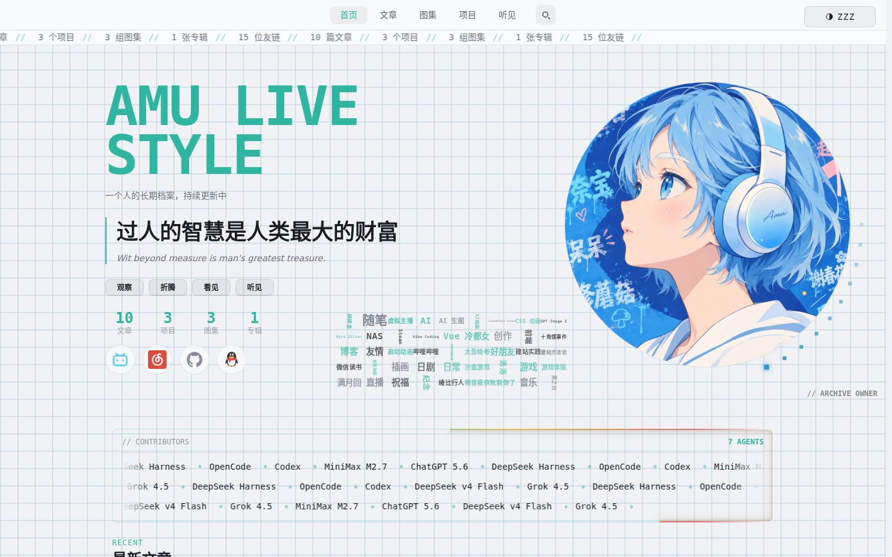 |  |
| 三主题菜单 | — | 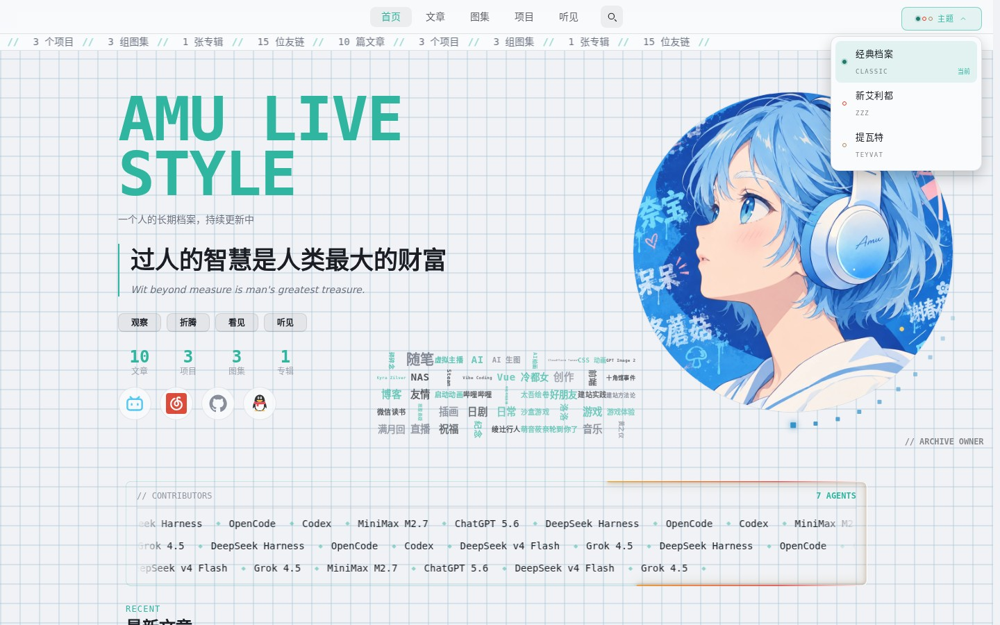 |
| ZZZ 顶栏 | 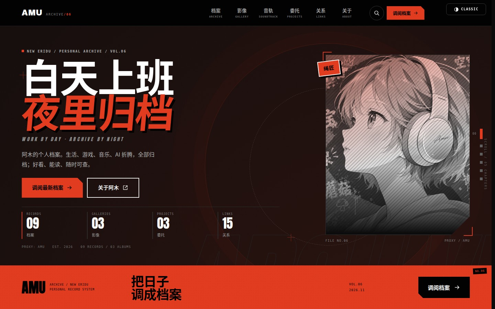 | 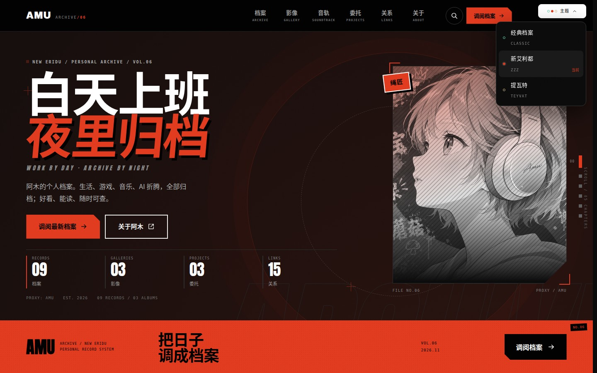 |

新主题页面：

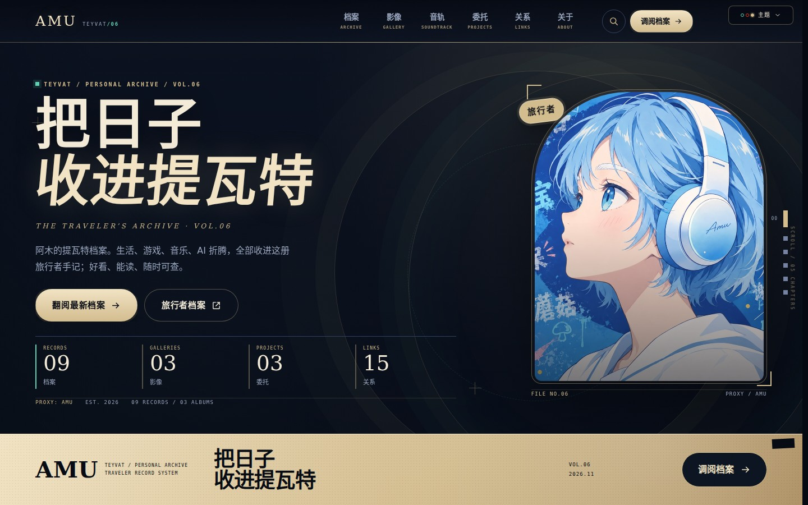
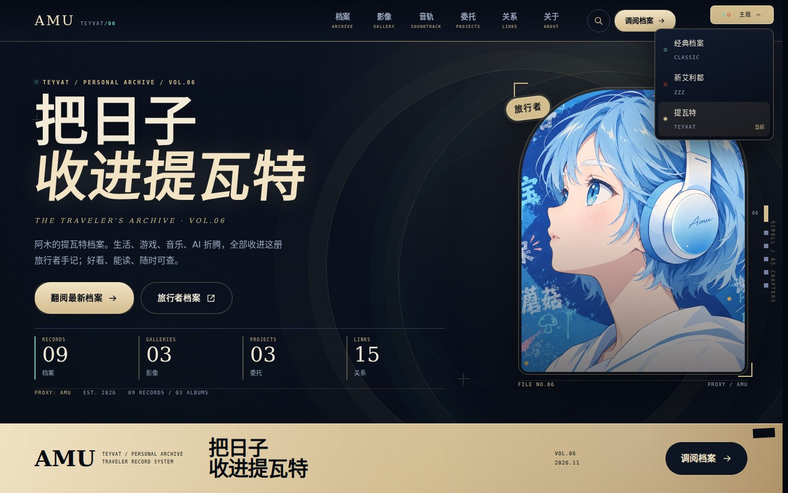
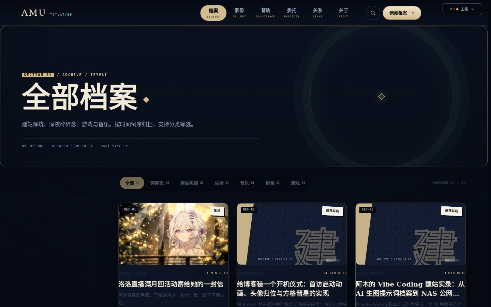
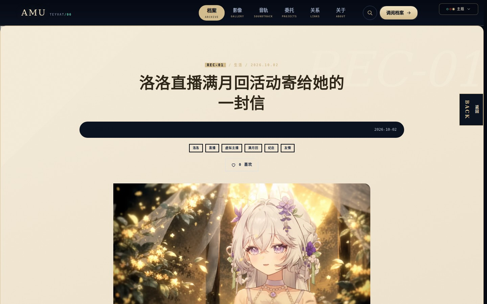
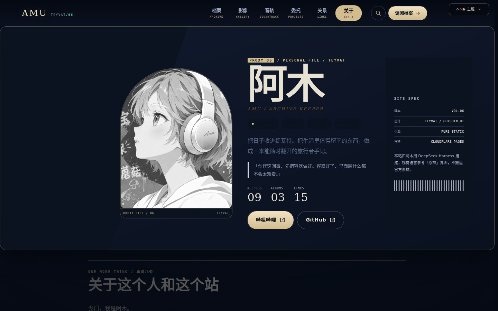
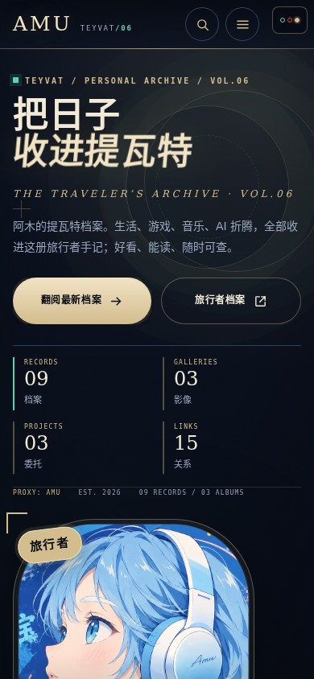

圆扩散：

| 经典 → 提瓦特 | 提瓦特 → 经典 |
|---|---|
| 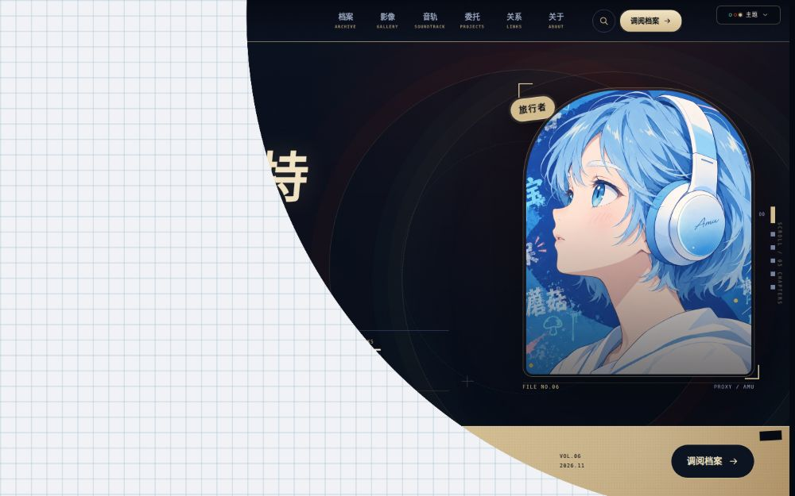 | 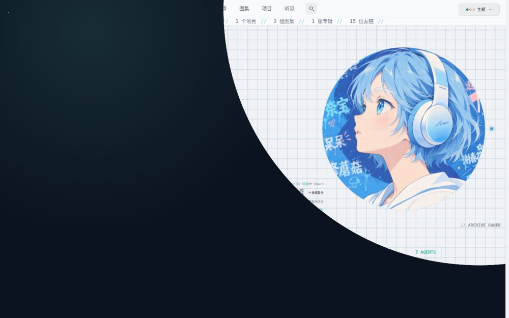 |

## 构建与部署

- `pnpm build` = `vite-ssg build` + `node zzz/scripts/build.mjs` + `node genshin/scripts/build.mjs`；
  输出 `dist/`、`dist/zzz/`、`dist/genshin/`。
- Cloudflare Pages 合并到 `master` 后自动部署。
- **GitHub Pages 未执行**：`amu263/amuboke-no.zero` 没有启用 Pages；`amu263.github.io` 是另一个仓库，
  当前 agent 只有博客仓库只读权限，无法写过去；项目站点还需要 `/amuboke-no.zero/` 的 base path。
  需要站长启用 Pages / 提供部署目标与权限后才能补。
